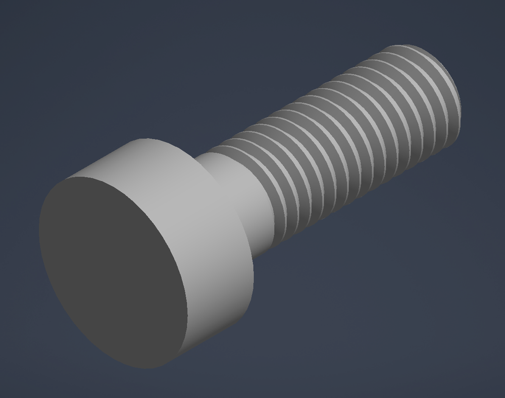
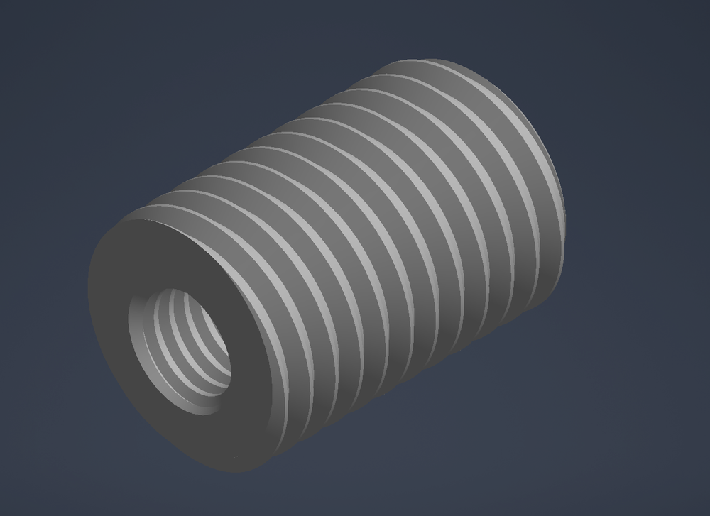
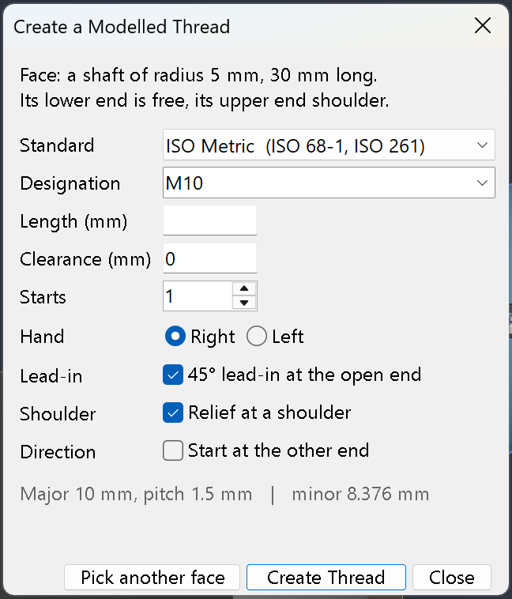
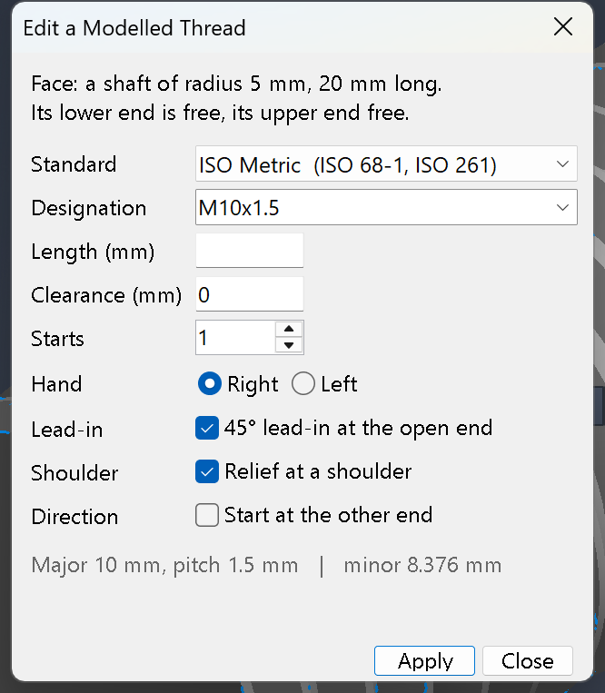

# Modeled Threads for Autodesk Inventor 2025–2027

Cuts a **real, modelled thread** into any cylindrical face — a shaft, a boss, a
through hole or the wall of a blind hole. There is no cosmetic thread to create
first and nothing to convert: pick the face, choose a size, and the thread is
cut into the solid.



<p align="center">
  
</p>

## What it does

* **External and internal.** A face outside a hole gets a screw thread; a face
  inside one gets a nut thread, with the profile the standard gives for each.
* **Through and blind.** The ends of the face are read from the geometry: a free
  end, a shoulder, a closed hole bottom, or an end that runs off into another
  feature. Each is treated differently, so a flange, a shoulder, a hole bottom
  or a sealing face keeps its shape and its area. A counterbore's bottom is a
  shoulder, not a blind hole, when a smaller hole carries on through it.
* **A lead-in and a relief.** An open end gets the 45° lead-in cone; a shoulder
  gets a relief so the thread runs out before it: one pitch wide on a shaft, a
  pitch and a half in a hole, where a tap needs more room to run out.
* **Multi-start, left or right hand, with clearance.** 1 to 8 starts, a lead of
  pitch × starts, and a per-thread clearance that takes material off the flanks
  as well as the root.
* **Editable.** Double-click the thread — in the browser or on the model — and
  the same dialog opens on it, ready to cut a different size in place.

Everything is a normal Inventor feature: the thread is a coil cut plus two
revolved cuts, all named, all editable, all visible in the browser.

<p align="center">
  
</p>

<p align="center"><i>One part, threaded twice: M20 × 2.5 on the outside and
M10 × 1.5 in the hole, with the wall between them untouched.</i></p>

## Requirements

| | |
|---|---|
| Inventor | 2025, 2026 or 2027 (built against 2025's interop, so one DLL runs on all three) |
| Windows | 10 or 11, 64-bit |
| Runtime | .NET Framework 4.8 — already part of Windows, nothing to install |

## Installing

Three ways, all of them per user with no administrator rights:

1. **Double-click `install.bat`.** It copies `bundle\ModeledThreads.bundle` into
   `%APPDATA%\Autodesk\ApplicationPlugins`, where Inventor looks for add-ins.
2. **`powershell -ExecutionPolicy Bypass -File install.ps1`** — the same thing,
   with a hash printed at the end. Add `-Uninstall` to remove it.
3. **`ModeledThreads-Setup.exe`** — compile `installer.iss` with Inno Setup
   (`iscc installer.iss`) for a signed-able, one-click installer.

Inventor must be closed while installing: it holds the DLL open while it runs.

### The first run

Inventor asks once about any add-in it has not seen before:

> **Add-in Manager Security Alert** → *Launch Add-in Manager* → select
> **Modeled Threads** → **Unblock** → OK.

That is a one-off per user. Signing `ModeledThreads.dll` with a trusted
certificate removes the prompt (see [Signing](#signing)).

## Using it

1. Open a part and either **select a cylindrical face** or press **Create
   Thread** on the *Modeled Threads* tab (Inventor then asks for the face).
2. The dialog fills itself in for the face: whether it is a shaft or a hole, its
   radius, its length and what each end is. The suggested size is the one that
   fits the face, with its pitch spelled out (`M10x1.5`, not just `M10`).
3. Choose the standard and size, then any of:

| Field | What it does |
|---|---|
| Standard | ISO metric, trapezoidal, Acme, buttress, BSPP (G) or Rp |
| Designation | The size; type it or pick it. The detected size spells out its pitch — a coarse M10 is shown as `M10x1.5` — and the list does the same. `M10` still parses, as do `M10x1.25`, `Tr20x4`, `1/2-10 ACME`, `G 1/2`, `Rp 1/2` |
| Length | How much of the face to thread, in mm. Empty means all of it |
| Clearance | Extra material cut from the thread, in mm |
| Starts | 1 to 8; the lead becomes pitch × starts |
| Hand | Right or left |
| Lead-in | The 45° cone at the open end the thread starts at |
| Shoulder | The relief at a shoulder: one pitch on a shaft, a pitch and a half in a hole |
| Direction | Start at the other end of the face |

4. **Create Thread** cuts it and closes the dialog.

If the size cannot be cut — a thread longer than the face, say — the dialog says
so and stays open. Nothing is cut until it can be cut properly.

<p align="center">
  
</p>

## Editing a thread

A thread made this way is not a one-shot: it can be opened and changed.

* **Double-click it.** In the browser, double-click the thread's own row (or
  double-click the thread on the model). The plugin's dialog opens instead of
  Inventor's coil editor, filled in with what the thread was made with.
* **Or select it and press Edit Thread** on the *Modeled Threads* tab. If
  nothing is selected, Inventor asks for the thread.

Change whatever needs changing — size, length, clearance, starts, hand, end
treatments, direction — and press **Apply**. The dialog looks exactly like the
one that made the thread:

<p align="center">
  
</p>

The old thread's features are taken out and the new ones are cut in their place,
all in one transaction: if anything fails, the thread is left exactly as it was
and the dialog says why. The surface the thread was cut into is read again after
the old features are gone, rather than replayed from the record, so an edit also
picks up a corrected reading of its ends. A whole cylinder's face starts and ends
at its seam, and the normal read there can come back from the wrong side — a
bore reading as a shaft — so the normals are sampled away from the seam and the
answer is the one they agree on. The new features keep the thread's identity, so
the same gesture edits it again.

The dialog knows what the thread was made with because each of its features
carries the inputs as a small text attribute (`ModeledThreads` / `Thread`). The
attribute is plain data: it costs nothing in the model and nothing in the file,
and it is only read when the plugin is asked to edit.

## What gets built

A thread is two or three features:

| Feature | What it is |
|---|---|
| `Modeled Thread <size>` | The groove, as a profile of the standard's own shape swept along a helix (a coil cut) |
| `Modeled Thread Lead-in <size>` | The 45° cone at the open end, so the first teeth engage (ISO 4753) |
| `Modeled Thread Relief <size>` | A pitch (a pitch and a half in a hole) revolve at a shoulder, so the thread runs out cleanly |

The planes and axes the cuts are built on are made as **construction** features,
so they never appear in the browser or across the part: the only things the
thread leaves behind are its own features.

Each of those features carries the thread's inputs in an attribute set named
`ModeledThreads`, attribute `Thread`. That is what the Edit command reads, and it
is why a thread can be changed without keeping anything else around.

The profile is the standard's, not an approximation: for ISO metric it is the
ISO 68-1 basic profile (H = P√3/2, depth 5H/8, flat P/8 at the crest and P/4 at
the root), and the resulting minor diameter matches the ISO 261/262 tables. The
cut volume agrees with the analytic groove volume to better than 0.01%.

Clearance moves the whole groove sideways rather than only deepening it, so both
the flanks and the root make room: a shaft's teeth get thinner and its root
deeper, a hole's teeth get thinner and the hole wider. That is what makes a
printed or a worn thread actually fit.

### The ends

| End | What happens |
|---|---|
| Free (open end) | Lead-in cone if asked for; the thread runs one pitch past the face into air |
| Shoulder | The relief — one pitch wide outside, a pitch and a half inside — so the last turn ends before the face |
| Closed (hole bottom) | The thread stops one pitch short of the bottom, so a plain band of wall is left there |
| Counterbore shoulder | A flat end with a smaller hole through it: treated as a shoulder, so the thread runs up to it and gets its relief |
| Joint between two bodies | A flat end where a second body is butted on, with a smaller hole carrying on through it: read as a shoulder, so the thread runs up to the joint and gets its relief |
| Inside (runs into another feature) | Treated as a shoulder |

The end is read from what the hole itself meets, and a smaller hole carrying on
through the flat end is what tells a shoulder from a bottom. A hole's relief is
wider than a shaft's because a tap has to run out past the last thread, while a
die only needs the thread to stop. Every face on the
end plane is looked at, not only the one the hole's wall happens to touch: a
part can be two bodies butted together, and the smaller hole is then bored into
the body behind. Material of another body lying beyond the end is not taken for
air either, so a thread never runs out through the body a part is joined to.

In a part of more than one body each cut is also aimed explicitly at the body
whose face is being threaded. Inventor aims a cut at the first body by default,
and a cut that belongs to another body would otherwise do nothing, silently.

## Opening the part without the add-in

A part with a modelled thread is an ordinary Inventor part. Everything the
thread is made of is a normal coil cut and normal revolved cuts; the attribute
that records the inputs is inert text on those features, like a part number.

So on a machine without the plugin the part opens, rebuilds, measures, saves and
prints exactly as it did here. The thread is still there, and Inventor's own
tools still work on it: double-clicking it opens Inventor's coil editor, and the
coil and the end cuts can be edited, suppressed or deleted like any others.
What is missing is only the plugin's own layer — the *Modeled Threads* tab, the
dialog that knows the standard's size, and the one-gesture re-cut with a
different size. Nothing is lost by saving again without the plugin; the recorded
inputs stay in the file for the next machine that has it.

The one thing not to do is delete the thread's features by hand and expect the
record to be cleaned up with it: it goes with the features, which is the point —
but the *part* is fine either way.

## Thread standards

| Standard | Designation | Notes |
|---|---|---|
| ISO metric | `M10`, `M10x1.25` | ISO 68-1 profile, ISO 261/262 sizes, coarse and fine |
| ISO metric trapezoidal | `Tr20x4`, `Tr40x14(P7)` | ISO 2904 profile, ISO 2902 sizes |
| Acme | `1/2-10 ACME`, `1 1/8-5 ACME` | ASME B1.5 |
| Buttress (metric) | `S20x4` | DIN 513 profile, 3°/30° |
| Buttress (ASME) | — | ASME B1.9 profile only; no size table yet, so it is not offered |
| BSPP, parallel | `G 1/2` | ISO 228-1 |
| Rp, parallel internal | `Rp 1/2` | ISO 7-1 |

The tables and the parsing live in `Core/ThreadCatalog.cs`; the profiles in
`Core/ThreadForms.cs`. Neither depends on Inventor's cosmetic-thread XML — the
add-in carries its own numbers.

## Limits worth knowing

* Straight, parallel threads only. Tapered (NPT, BSPT) and trumpet threads are
  not cut.
* The thread ends one pitch past a free end. That is deliberate: it leaves a
  complete turn rather than a partial one, and the lead-in cone takes the edge.
* Very fine threads on large diameters make a small coil: the add-in stops at
  400 turns (Inventor's own ceiling for a coil is higher, but a thread that long
  is not a thread), so use a coarser pitch on a long face.
* The add-in does not change Inventor's own Thread and Hole commands; those still
  put cosmetic threads on. This is the other thing, for when the thread has to be
  in the model.

## Logging

Everything the add-in does is written to
`%LOCALAPPDATA%\ModeledThreads\modeled-threads.log`. If a thread will not cut,
the reason is in there.

## Building

```
./build.ps1                 # Release, built against Inventor 2025, add-in and harness
./build.ps1 -SkipHarness    # the add-in alone
```

Needs a .NET SDK (10.0 or newer) on the build machine: the add-in and harness
would build with 6.0, but `tools/ThreadMath` targets `net10.0`. The add-in targets
**.NET Framework 4.8**, which is why nothing has to be installed on the machine
that runs Inventor; the SDK is only needed to compile.

The build copies `ModeledThreads.dll` into `bundle/ModeledThreads.bundle/Contents`,
so that folder is always the thing to install or zip.

## Testing

Two harnesses, both worth running after any change to the profile or the plan:

**`tools/ThreadMath`** — the maths, with no Inventor in sight, so it runs
anywhere:

```
dotnet run --project tools/ThreadMath -c Release
```

It checks every designation in every table parses and reads back as itself, the
ISO 2904 trapezoidal numbers against the standard's tables, the plan's turn
volume, where a thread stops at each kind of end (a pitch into the air at a free
one, a pitch clear of a blind hole's bottom, the relief at a shoulder: a pitch
and a half wide in a hole), and that the size offered for a 10 mm shaft is an M10.

**`tools/TestHarness`** — real geometry in Inventor, through the same code the
add-in uses:

```
tools\TestHarness\bin\Release\ThreadHarness.exe
```

`--pid <pid>` keeps the run in one Inventor instance: start a second, empty one
and point the harness at it, and the checks never go near a part the user has
open.

It builds parts, cuts threads and measures what came out: the volume removed
against the plan, the length and the end faces of the part, the flange and hole
mouths that must not change, the lead-in, the relief, and that clearance removes
more material. Both internal threads are checked in full: a through hole has to
open out to the major diameter at both mouths, and a blind hole has to be opened
out at its mouth while its bottom stays a whole disk with a plain band of wall
above it. A tube is threaded twice, outside and then inside, and the checks hold
the wall between the two cuts. A counterbore shoulder gets the full treatment: a
30 mm counterbore 7 mm deep with an 8.5 mm hole through it must read as a
shoulder, take an M33x2 thread right up to it, add the relief, and leave the
smaller hole and its wall untouched. The same shoulder is then made the hard
way, by butting a second body against the first with a smaller hole bored
through it: the joint has to read as a shoulder as well, take the same thread
and the same relief, and leave the second body's hole whole.

It also edits: a thread is cut, its record is read back from every feature and
from a face the thread made, and then the thread is replaced with a different
size through the same code the dialog uses. The checks hold the volume change,
that no feature of the old size is left, and that the same thread — same id, same
number of features — is the only one in the part. That is done twice: once on a
shaft and once in a hole, for an internal thread.

109 checks, and it saves `C:\Temp\demo-plain.ipt` (a clean shaft),
`C:\Temp\demo-nut-plain.ipt` (a clean hole), `C:\Temp\demo-blind-plain.ipt` (a
clean blind hole), `C:\Temp\demo-tube-plain.ipt` (a clean tube),
`C:\Temp\demo-bolt.ipt` (a threaded shaft), `C:\Temp\demo-nut.ipt` (a threaded
nut), `C:\Temp\demo-tube.ipt` (threaded inside and out) and
`C:\Temp\demo-edit.ipt` (a shaft whose thread was edited in place) so the result
can be looked at.

**`tools/ThreadDoctor`** — reaches one particular Inventor instance through the
running object table (a second, empty instance is easy to start by accident) and
lists the documents and threads in it, with the ends it reads for each thread's
face.

```
ThreadDoctor <pid>                        list the threads
ThreadDoctor <pid> --docs                 every document, with its features
ThreadDoctor <pid> --apply "<name>"       re-cut a thread in place
ThreadDoctor <pid> --apply "<name>" --designation M33x1.5
ThreadDoctor <pid> --create M33x1.5 --radius 15 [--external]
ThreadDoctor <pid> --open <path> ...      open a part first
ThreadDoctor <pid> --quit                 close without saving, and quit
```

`--apply` goes through the same code as the dialog after saving a copy of the
part, so a part that is already open can be corrected without losing it;
`--designation` gives the re-cut a size other than the one it had. `--create`
cuts a new thread on the longest face of the given radius, on the inside or, with
`--external`, the outside: that is how a part whose unsaved threads were lost
can be put back without the dialog. `--quit` is for a test instance started for
`--pid`.

`tools/vm` holds the scripts used to drive all of this inside a Windows VM from
the host: running the harness in the user's desktop session, opening a part,
pressing buttons through UI Automation, and screenshotting the result.

Running anything in the user's desktop session normally goes through the Task
Scheduler. When the scheduler itself is stuck (launch requests queue and never
start, which happens after a VM is suspended and resumed), `tools/SessionRunner`
takes the console session's own token and starts the command with it:

```
C:\Temp\SessionRunner.exe --wait powershell -NoProfile -File C:\Temp\script.ps1
```

It prints the pid and, with `--wait`, the exit code. That is what makes
`tools/vm/open-part.ps1` and `tools/vm/create-thread.ps1` usable from the host.

## Signing

To remove the first-run security prompt, sign the DLL with a certificate
Windows trusts:

```
signtool sign /fd SHA256 /tr http://timestamp.digicert.com /td SHA256 ^
    /f mycert.pfx /p <password> bundle\ModeledThreads.bundle\Contents\ModeledThreads.dll
```

Sign after `build.ps1` has copied the DLL into the bundle, and before making the
installer.

## Code layout

| Path | What is in it |
|---|---|
| `Core/ThreadForms.cs` | The standards' profiles and the groove geometry |
| `Core/ThreadCatalog.cs` | Size tables, designation parsing, tap drills |
| `Core/ThreadPlan.cs` | Ends, lead-in, relief, turn volume — the plan for one thread |
| `Core/FaceProbe.cs` | Reading a face: axis, radius, extent, inside or outside, its ends |
| `Core/ThreadRecord.cs` | The inputs a thread was made with, and the attribute that carries them |
| `Core/ThreadBuilder.cs` | The Inventor features: sketch, coil cut, revolve cuts |
| `Core/ThreadEditor.cs` | Finding a thread, taking it out and cutting it again |
| `UI/CreateThreadForm.cs` | The dialog, in create and edit mode |
| `StandardAddInServer.cs` | Ribbon, face picking, command entry point, double-click |
| `Compatibility/CompilerFeatures.cs` | The few newer C# features .NET Framework 4.8 lacks |

The split matters: everything above `ThreadBuilder.cs` is plain maths with no
Inventor types, which is what makes `tools/ThreadMath` possible.
